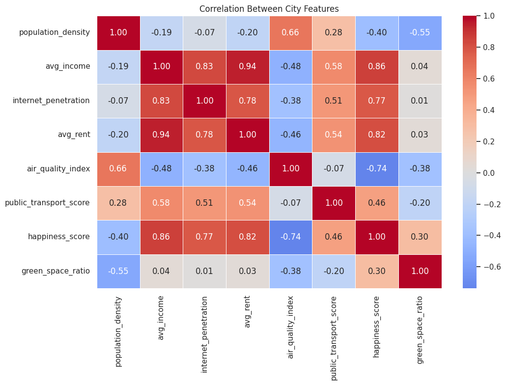
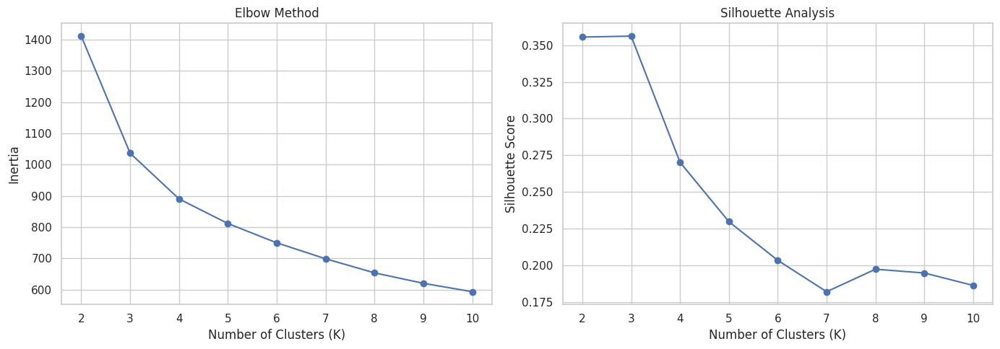
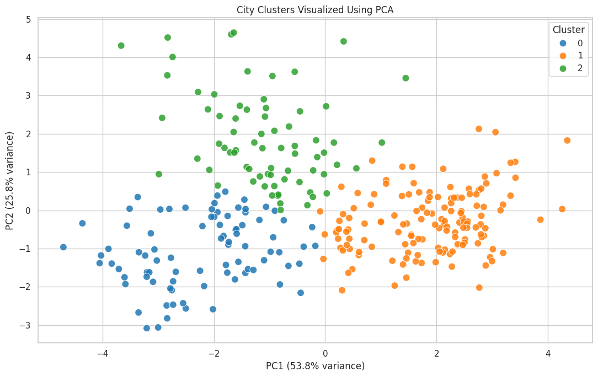
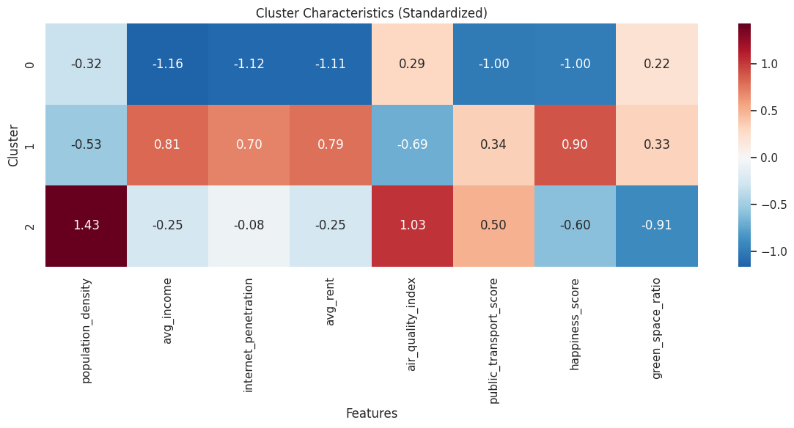
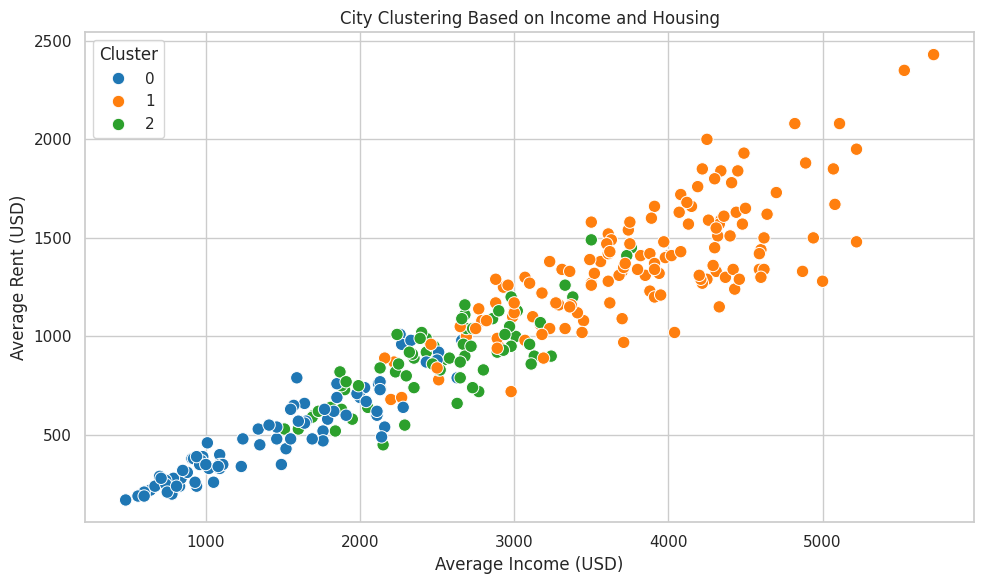
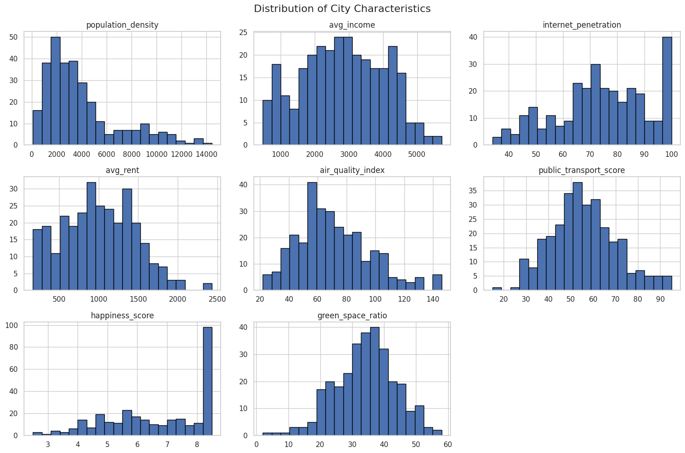

# City/Area Clustering

## Overview

City/Area Clustering groups city profiles with similar demographic, economic, infrastructure, environmental, and quality-of-life characteristics using **K-Means clustering**. The project is implemented in Python in a Google Colab/Jupyter notebook.

The dataset contains **300 synthetic city profiles** and eight numerical features used for clustering. Since the data is synthetic, the results demonstrate a machine-learning workflow and should not be interpreted as verified findings about real cities.

## Objectives

- Explore and understand the city dataset.
- Examine feature distributions and correlations.
- Scale numerical features before distance-based clustering.
- Compare candidate cluster counts using the Elbow Method and Silhouette Score.
- Apply K-Means and visualize the clusters using PCA.
- Interpret cluster profiles and compare city characteristics.

## Dataset

File: [`city_lifestyle_dataset.csv`](city_lifestyle_dataset.csv)

The dataset includes the following numerical features:

| Feature | Description |
|---|---|
| `population_density` | Population density |
| `avg_income` | Average monthly household income (USD) |
| `internet_penetration` | Internet access percentage |
| `avg_rent` | Average monthly rent (USD) |
| `air_quality_index` | Air-quality index |
| `public_transport_score` | Public transportation score |
| `happiness_score` | Happiness/life-satisfaction score |
| `green_space_ratio` | Percentage of area covered by green space |

`city_name` and `country` are retained for identification and reporting, but excluded from the numerical clustering input.

## Methodology

1. Load the CSV and inspect its structure.
2. Check missing values, data types, descriptive statistics, and duplicate rows.
3. Select the eight numerical features and handle missing numerical values if needed.
4. Apply `StandardScaler` so features with different scales can contribute more comparably to distance calculations.
5. Perform exploratory data analysis (EDA), including distributions and correlation analysis.
6. Evaluate candidate values of **K = 2–10** using the Elbow Method and Silhouette Score.
7. Fit the final K-Means model.
8. Use PCA to visualize the eight-dimensional data in two dimensions.
9. Compare cluster profiles and export the assigned cluster labels.

## Visual Results

### 1. Feature Correlations

The heatmap summarizes pairwise correlations between the numerical features.

### 2. Selecting the Number of Clusters

The Elbow Method compares inertia across different values of K, while the Silhouette Score measures how well-separated the resulting clusters are.

### 3. PCA Cluster Visualization

PCA projects the scaled feature space into two dimensions to help visualize the cluster assignments. This is a visualization of the model results, not the space in which K-Means was fitted.

### 4. Cluster Characteristics

The standardized heatmap compares each cluster's average feature values relative to the overall scaled feature means.

### 5. Income and Housing Comparison

This scatter plot compares average income and average rent, with points coloured by their assigned cluster.

### Feature Distributions

The histograms show the distribution of each numerical feature.

View feature distributions

## Final Clustering Results

The reported K-Means result contains three clusters:

| Cluster | Number of cities | Share of dataset | General profile |
|---|---:|---:|---|
| Cluster 0 | 85 | 28.3% | Lower average income, rent, internet penetration, transport score, and happiness compared with the dataset mean |
| Cluster 1 | 143 | 47.7% | Higher average income, rent, internet penetration, and happiness compared with the dataset mean |
| Cluster 2 | 72 | 24.0% | Higher population density and air-quality index, with lower green-space ratio and happiness compared with the dataset mean |

These profiles are descriptive interpretations of the supplied model output. Cluster numbers are labels, not rankings. A higher air-quality index indicates worse air quality according to the dataset description.

## Technologies

- Python
- Pandas and NumPy
- Matplotlib and Seaborn
- Scikit-learn
- Google Colab / Jupyter Notebook

## Repository Contents

| File | Description |
|---|---|
| `City_Area_Clustrinng.ipynb` | Notebook containing the analysis and clustering workflow |
| `city_lifestyle_dataset.csv` | Dataset used for the project |
| `City_Area_Clustering_Minor_Project_Report.docx` | Minor project report |
| `correlation-heatmap.png` | Feature correlation matrix |
| `optimal-clusters-analysis.png` | Elbow and silhouette plots |
| `pca-cluster-visualization.png` | PCA visualization of cluster assignments |
| `cluster-characteristics.png` | Standardized cluster profile heatmap |
| `income-vs-rent-clusters.png` | Income versus rent scatter plot |
| `feature-distributions.png` | Feature distribution histograms |

## How to Run

1. Open `City_Area_Clustrinng.ipynb` in Google Colab or Jupyter Notebook.
2. Ensure `city_lifestyle_dataset.csv` is available in the notebook environment.
3. Run the cells in order to reproduce the analysis, evaluate K, fit K-Means, and generate the visualizations.

## Limitations

- The dataset is synthetic and does not represent verified measurements of real cities.
- K-Means is sensitive to feature selection, scaling, outliers, and the chosen value of K.
- PCA compresses the feature space into two dimensions, so some information is not visible in the plot.
- Cluster labels describe similarity patterns; they do not establish causation or an objective ranking of cities.
